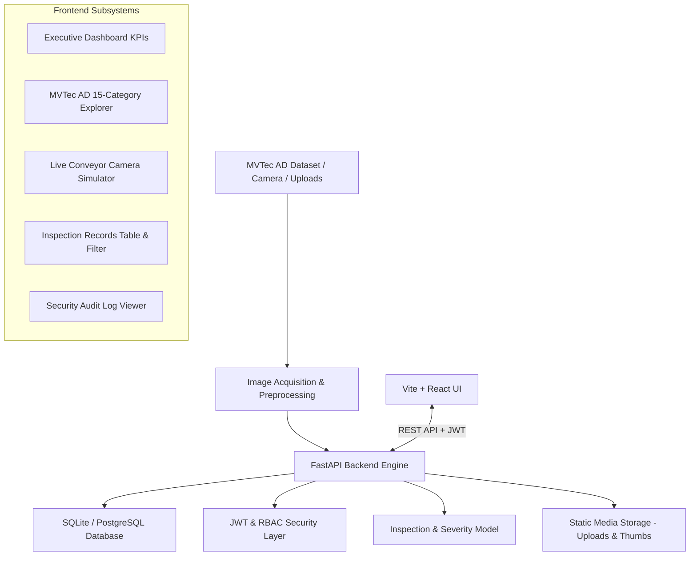

# VisionInspect AI — System Architecture (Milestone 1)

## 1. High-Level Architecture Overview

VisionInspect AI is an industrial-grade quality control and defect detection platform designed for smart manufacturing and Industry 4.0 environments.

## 2. Core Architectural Layers

### 1. Data Input Sources & Ingestion
- **Manual Image Upload**: Supports drag-and-drop single & batch uploads with format validation (PNG, JPG, BMP, TIFF) and 25MB file size limits.
- **Conveyor Belt & Camera Simulation**: Real-time simulated industrial camera feed (`CAM-LINEA-04`) with laser crosshairs and automated streaming ingestion.
- **MVTec AD Dataset Repository**: Direct access to all 15 industrial categories (`bottle`, `cable`, `capsule`, `carpet`, `grid`, `hazelnut`, `leather`, `metal_nut`, `pill`, `screw`, `tile`, `toothbrush`, `transistor`, `wood`, `zipper`).

### 2. Backend Engine (FastAPI)
- **FastAPI 0.110+**: Asynchronous API server with OpenAPI (Swagger) documentation at `/docs`.
- **SQLAlchemy ORM**: Database abstraction supporting SQLite for zero-friction local execution and PostgreSQL for cloud scaling.
- **Image Preprocessing Service**: Computes SHA-256 integrity hash, dimensions, RGB channel validation, and thumbnail generation using Pillow and NumPy.

### 3. Security & Role-Based Access Control (RBAC)
- **JWT (JSON Web Tokens)**: Signed using HMAC-SHA256 with 7-day expiration.
- **Roles**:
  - `quality_engineer`: Line inspections, image acquisition, sample validation, manual decision overrides.
  - `factory_supervisor`: Batch management, inspection deletion, operational reports, compliance audits.
  - `production_manager`: Plant-wide KPI analysis, quality trends, system audit logs.

### 4. Severity Assessment Framework
As specified in Section 5 of the project specification:
$$\text{Severity Score} = (\text{Size} \times 30\%) + (\text{Location} \times 25\%) + (\text{Defect Type} \times 25\%) + (\text{Confidence} \times 20\%)$$

- **Severity Levels**:
  - `0–39`: Low (Minor cosmetic defect)
  - `40–59`: Medium (Moderate concern)
  - `60–79`: High (Significant issue; rework)
  - `80–100`: Critical (Major defect; rejection)
