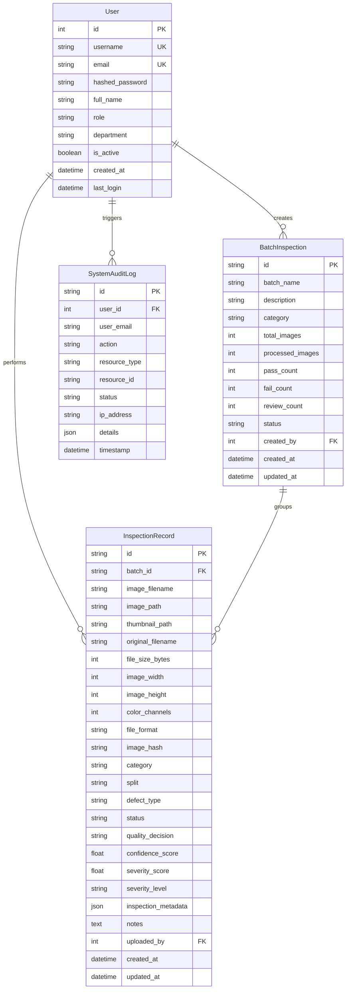

# VisionInspect AI — Database Schema & Data Dictionary

## 1. Entity Relationship Diagram (ERD)

## 2. Table Specifications

### `users`
Stores user identities, hashed credentials, department assignments, and RBAC roles (`quality_engineer`, `factory_supervisor`, `production_manager`, `admin`).

### `batch_inspections`
Aggregates manufacturing line batches with total unit counts, pass/fail totals, and line status.

### `inspection_records`
Core inspection entity storing raw and thumbnail image paths, image dimensions, SHA-256 integrity hash, MVTec AD category, defect classification, severity scoring (0–100), pass/fail decision, and operator notes.

### `system_audit_logs`
Compliance audit trail logging user authentication, image ingestion, batch creation, and manual decision overrides.
